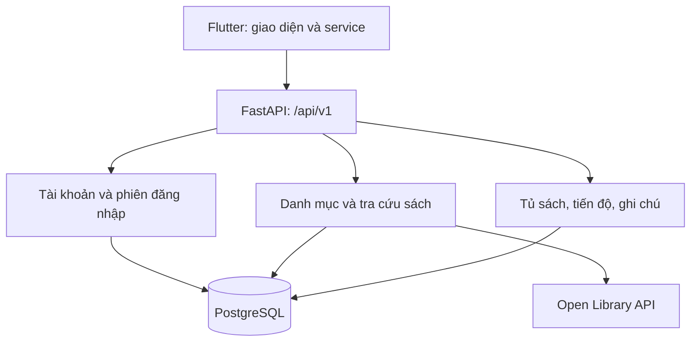

# Thiết kế backend — Open Library Client

> Backend FastAPI đã được tạo trong `backend/`; xem `backend/README.md` để cài đặt và chạy. Flutter đã kết nối với API cho tài khoản, danh mục, cài đặt, tủ sách, tiến độ và ghi chú. Migration và luồng API đã được kiểm thử với PostgreSQL cục bộ. Tài liệu này mô tả hợp đồng API và quy tắc nghiệp vụ.

## 1. Backend cần làm gì?

- Lưu tài khoản, đăng nhập, sửa hồ sơ, đổi mật khẩu và khôi phục mật khẩu.
- Cung cấp danh mục 30 sách, sách nổi bật, thể loại và tìm kiếm sách.
- Lấy thông tin tác phẩm, tác giả, phiên bản và URL bìa từ Open Library khi người dùng cần.
- Lưu tủ sách riêng cho mỗi tài khoản, trạng thái đọc, tiến độ và ghi chú.
- Lưu lựa chọn ngôn ngữ/giao diện; đồng bộ sau khi đăng nhập trên thiết bị khác.

Tài khoản của app là tài khoản do nhóm quản lý, không phải tài khoản đăng nhập Open Library. Tủ sách trong app không tự đồng bộ với tủ sách trên website Open Library.

### Hiện trạng đã kiểm tra

File `auth_service(1).dart` đã gửi dùng `Map _accounts` giữ cả mật khẩu và tài khoản trong bộ nhớ, có tài khoản demo, dùng độ trễ giả và không thực sự gửi email khôi phục. Backend mới thay phần xử lý này bằng API. Đây là nhận xét về bản file đã gửi; chưa kiểm tra toàn bộ code mới nhất trên máy Mac.

## 2. Kiến trúc



Bìa sách: app nhận URL từ backend và tải ảnh trực tiếp; 30 ảnh nhóm tự thiết kế có thể tiếp tục dùng asset trong Flutter. Backend trả một khóa `localCoverKey` nếu cần ánh xạ asset, không trả đường dẫn tuyệt đối trên máy lập trình viên.

| Thành phần | Lựa chọn đề xuất | Mục đích |
|---|---|---|
| Ngôn ngữ | Python | Viết logic server và script nhập danh mục |
| HTTP API | FastAPI | Nhận/trả JSON, kiểm tra dữ liệu, sinh OpenAPI |
| Cơ sở dữ liệu | PostgreSQL | Lưu bền vững, quan hệ và giao dịch |
| ORM / migration | SQLAlchemy 2 + Alembic | Đọc ghi dữ liệu và quản lý thay đổi schema |
| HTTP client | HTTPX | Gọi Open Library có timeout |
| Mật khẩu | Argon2 qua pwdlib | Lưu hash thay vì mật khẩu gốc |
| Xác thực | Access JWT + refresh token ngẫu nhiên | Phiên đăng nhập có thể thu hồi |
| Kiểm thử | pytest + HTTPX | Kiểm tra API và phân quyền |
| Chạy phát triển | Uvicorn, một worker; Docker Compose cho PostgreSQL nếu máy có Docker | Giữ môi trường nhóm thống nhất |

Bản đầu không cần microservice, Redis hoặc hàng đợi riêng. Cache và limiter trong bộ nhớ chỉ dùng khi chạy một worker; nếu mở rộng nhiều worker/instance phải dùng kho cache và giới hạn tốc độ dùng chung.

## 3. Các module và file backend

Đặt backend bên trong repository hiện tại: `open_library_client/backend/`. Không tạo một bản Flutter thứ hai.

| Đường dẫn | Trách nhiệm |
|---|---|
| `backend/app/main.py` | Tạo FastAPI, đăng ký router, handler lỗi, lifespan |
| `backend/app/core/config.py` | Đọc cấu hình từ biến môi trường |
| `backend/app/core/security.py` | Hash mật khẩu, ký/kiểm tra token, tạo token ngẫu nhiên |
| `backend/app/core/errors.py` | Chuẩn lỗi thống nhất |
| `backend/app/db/session.py` | Kết nối và transaction |
| `backend/app/db/models.py` | Model SQLAlchemy và ràng buộc |
| `backend/app/api/deps.py` | Lấy current user, kiểm tra session |
| `backend/app/modules/auth/router.py`, `schemas.py`, `service.py` | Đăng ký, đăng nhập, refresh, đăng xuất, reset |
| `backend/app/modules/users/router.py`, `schemas.py`, `service.py` | Hồ sơ và cài đặt |
| `backend/app/modules/books/router.py`, `schemas.py`, `service.py` | Danh mục, tìm kiếm, chi tiết, phiên bản |
| `backend/app/modules/books/open_library_client.py` | Chuẩn hóa dữ liệu và giới hạn yêu cầu tới Open Library |
| `backend/app/modules/bookshelf/router.py`, `schemas.py`, `service.py` | Tủ sách, tiến độ, ghi chú |
| `backend/app/services/email_service.py` | Gửi email reset; adapter thật hoặc mail sink khi phát triển |
| `backend/scripts/import_catalog.py` | Nhập 30 sách, chạy lại không tạo trùng |
| `backend/data/catalog_30.json` | Bản danh mục dành cho script nhập, kiểm tra trước khi dùng |
| `backend/alembic/` | Migration và cấu hình Alembic |
| `backend/tests/` | Kiểm thử API, transaction, tài khoản và dữ liệu sách |
| `backend/pyproject.toml` và file khóa dependency | Khai báo, khóa phiên bản đã kiểm thử |
| `backend/.env.example` | Mẫu cấu hình, không chứa bí mật thật |
| `backend/compose.yaml` | PostgreSQL phát triển và volume lưu dữ liệu |
| `backend/README.md` | Cách thiết lập, migration, seed và chạy server |

Không khóa số phiên bản thư viện trong tài liệu này khi chưa cài và kiểm thử. Khi bắt đầu code, tạo file khóa và dùng cùng phiên bản trong nhóm.

## 4. Thiết kế dữ liệu

### 4.1. Tài khoản

| Bảng | Các trường chính | Quy tắc |
|---|---|---|
| `users` | `id UUID`, `email_normalized`, `display_name`, `password_hash`, `avatar_url nullable`, `is_active`, `created_at`, `updated_at` | Email trim + lowercase, UNIQUE; không trả hash qua API |
| `user_settings` | `user_id`, `theme`, `language`, `notifications_enabled`, `updated_at` | Một hàng mỗi user; theme system/light/dark; language vi/en |
| `auth_sessions` | `id UUID`, `user_id`, `expires_at`, `revoked_at nullable`, `created_at` | Session hết hạn/thu hồi thì access token không còn dùng được |
| `refresh_tokens` | `id UUID`, `session_id`, `token_hash UNIQUE`, `expires_at`, `used_at nullable`, `revoked_at nullable` | Chỉ lưu hash; token dùng một lần và xoay vòng |
| `password_reset_tokens` | `id UUID`, `user_id`, `token_hash UNIQUE`, `expires_at`, `used_at nullable` | Có hạn sử dụng, dùng đúng một lần |

Tạo user và settings trong cùng transaction. Thời gian lưu kiểu timezone-aware, dùng UTC trong DB và ISO 8601 trong API.

### 4.2. Sách

| Bảng | Các trường chính | Quy tắc |
|---|---|---|
| `books` | `work_id PK`, `title`, `authors JSONB`, `description nullable`, `summary_vi nullable`, `subjects JSONB`, `first_publish_year nullable`, `cover_url nullable`, `local_cover_key nullable`, `in_catalog`, `featured_rank nullable`, `fetched_at` | work_id dạng OL...W; danh mục 30 sách có in_catalog=true |
| `categories` | `id`, `slug UNIQUE`, `name_vi`, `name_en`, `sort_order` | Bộ thể loại do nhóm quản lý; không dùng trực tiếp hàng trăm subjects làm chip |
| `book_categories` | `work_id FK`, `category_id FK` | PK ghép; một sách có thể thuộc nhiều thể loại |
| `editions` | `edition_id PK`, `work_id FK`, `title`, `isbn10 JSONB`, `isbn13 JSONB`, `publishers JSONB`, `publish_date nullable`, `page_count nullable`, `languages JSONB`, `cover_url nullable`, `fetched_at` | edition_id dạng OL...M; UNIQUE(work_id, edition_id); số trang >0 hoặc null |

Trong bản đầu, tác giả là mảng JSON với mã, tên và URL nguồn; chưa cần bảng tác giả riêng. Khi cần trang tác giả và truy vấn quan hệ phức tạp mới tách bảng.

Phân biệt tác phẩm (work) và phiên bản (edition): số trang, ISBN và ngôn ngữ gắn với phiên bản. Không khẳng định mọi phiên bản của cùng sách có cùng số trang.

### 4.3. Dữ liệu cá nhân

| Bảng | Các trường chính | Quy tắc |
|---|---|---|
| `saved_books` | `id UUID`, `user_id FK`, `work_id FK`, `edition_id nullable`, `status`, `pages_read`, `total_pages nullable`, `version`, `created_at`, `updated_at` | UNIQUE(user_id, work_id); pages_read>=0; total_pages>0 hoặc null; pages_read<=total_pages khi biết tổng |
| `book_notes` | `id UUID`, `saved_book_id UNIQUE FK`, `content`, `version`, `created_at`, `updated_at` | Một ghi chú mỗi sách đã lưu, tối đa 10.000 ký tự |

- Trạng thái: `want_to_read`, `reading`, `finished`.
- Bookmark ở trang sách chính là thêm vào Tủ sách, mặc định Muốn đọc. Không tạo thêm bảng “favorites” trùng chức năng.
- Nếu chọn edition, dùng foreign key ghép (work_id, edition_id) tới editions để bảo đảm đúng tác phẩm.
- Xóa saved_book thì xóa ghi chú liên quan bằng ON DELETE CASCADE; không xóa metadata sách chung.
- Mọi truy vấn dữ liệu cá nhân phải lọc theo user lấy từ token. Không nhận user_id trong request để quyết định chủ sở hữu.
- Index: saved_books(user_id, status, updated_at), books(in_catalog), các khóa ngoại cần truy vấn.
- version dùng chống ghi đè khi hai thiết bị sửa cùng bản ghi: PATCH/PUT gửi expectedVersion, server cập nhật WHERE version=expectedVersion rồi tăng version; không khớp trả 409.

## 5. API

Tiền tố chung: `/api/v1`. Request và response JSON dùng camelCase; DB dùng snake_case. Ngoại lệ login vẫn nhận JSON riêng của app, không sao chép nguyên mẫu form OAuth2 rồi dùng sai content-type.

### 5.1. Auth và cá nhân

| Method | Endpoint | Dữ liệu / tác dụng |
|---|---|---|
| POST | /auth/register | displayName, email, password; 201 tạo tài khoản, không tự đăng nhập |
| POST | /auth/login | email, password; trả user và cặp token |
| POST | /auth/refresh | refreshToken; trả cặp token mới |
| POST | /auth/logout | Bearer access token; thu hồi session hiện tại; 204 |
| POST | /auth/forgot-password | email; luôn 202 với thông báo chung |
| POST | /auth/reset-password | token, newPassword; dùng reset token, đổi mật khẩu, thu hồi các phiên; 204 |
| GET | /me | Lấy user hiện tại |
| PATCH | /me | Sửa displayName; bản đầu email chỉ đọc |
| POST | /me/change-password | currentPassword, newPassword; thu hồi các phiên và yêu cầu đăng nhập lại; 204 |
| GET | /me/settings | Lấy theme, language, notificationsEnabled |
| PATCH | /me/settings | Chỉ cập nhật các giá trị được gửi |

Đổi email và upload avatar để giai đoạn sau: đổi email cần xác minh địa chỉ mới, còn avatar cần nơi lưu ảnh và kiểm tra file. Bản đầu dùng avatar mặc định/local của app; không upload đường dẫn file cục bộ lên DB rồi kỳ vọng thiết bị khác đọc được.

### 5.2. Khám phá, tìm kiếm và chi tiết

| Method | Endpoint | Dữ liệu / tác dụng |
|---|---|---|
| GET | /categories | Các thể loại do nhóm định nghĩa |
| GET | /books?category=...&page=1&pageSize=20 | Danh mục curated trong DB; thứ tự ổn định theo title, work_id |
| GET | /books/featured?limit=5 | Chọn theo featured_rank; không giả là điểm đánh giá người dùng |
| GET | /books/search?q=...&language=eng&sort=relevance&page=1&pageSize=20 | Tìm qua Open Library, cache, chuẩn hóa kết quả |
| GET | /books/{workId} | Thông tin tác phẩm; ưu tiên dữ liệu đã cache/seed |
| GET | /books/{workId}/editions?offset=0&limit=20 | Danh sách phiên bản từ Open Library, cache theo trang |

- Khai báo route /books/search và /books/featured trước route tham số /books/{workId}.
- /books là danh mục nhóm, /books/search là kết quả tìm từ nguồn ngoài. Không trộn hai nguồn thành một danh sách rồi vẫn dùng tổng số kết quả của Open Library.
- q: 2–200 ký tự, page>=1, pageSize 1–50. language thuộc danh sách mã cho phép; sort chỉ nhận relevance/newest/oldest và ánh xạ sang tham số nguồn đã được kiểm thử.
- Danh sách trả items, page, pageSize, hasMore và total nullable. Trường hợp nguồn ngoài không đảm bảo tổng chính xác, không tự tạo con số.
- Các mô tả, số trang, năm, tác giả có thể thiếu; trả null/mảng rỗng, không điền số giả.
- Đường dẫn “Mở trên Open Library” được server dựng từ workId hợp lệ.
- Link sách chỉ dẫn tới trang nguồn. API metadata không đồng nghĩa có toàn văn để đọc hoặc tải; bản đầu không tạo endpoint /books/{id}/full-text.

### 5.3. Tủ sách, tiến độ và ghi chú

| Method | Endpoint | Dữ liệu / tác dụng |
|---|---|---|
| GET | /me/books?status=reading&page=1&pageSize=20 | Danh sách tủ sách, sắp theo updatedAt giảm dần rồi id |
| PUT | /me/books/{workId} | Thêm nếu chưa có, body editionId tùy chọn; 201 tạo mới, 200 nếu đã có; không reset tiến độ của bản cũ |
| PATCH | /me/books/{workId} | status, pagesRead, editionId tùy trường hợp và expectedVersion |
| DELETE | /me/books/{workId} | Xóa sách và ghi chú trong một transaction; 204 |
| GET | /me/books/{workId}/note | Ghi chú hiện tại; content=null, version=0 nếu chưa có |
| PUT | /me/books/{workId}/note | content, expectedVersion; tạo khi version=0 hoặc sửa bản hiện tại |
| DELETE | /me/books/{workId}/note | expectedVersion qua query; xóa ghi chú; 204 |
| GET | /me/books/stats | Tổng sách và số lượng theo ba trạng thái |

Đăng ký route /me/books/stats trước /me/books/{workId} nếu có GET chi tiết. Không thêm riêng endpoint /reading nếu GET /me/books?status=reading đã đáp ứng.

## 6. Ví dụ JSON để nhóm Flutter thống nhất

### Đăng nhập

```http
POST /api/v1/auth/login
Content-Type: application/json
```

```json
{"email":"nghia@example.com","password":"mat-khau-nguoi-dung"}
```

Response 200 (các token dưới đây là ký hiệu minh họa):

```json
{
  "user": {"id":"e6da652e-349e-4b9c-923b-9e20239904ab","displayName":"Nghĩa","email":"nghia@example.com","avatarUrl":null},
  "accessToken":"<access-jwt>",
  "refreshToken":"<random-refresh-token>",
  "tokenType":"Bearer",
  "expiresIn":900
}
```

### Lưu sách

```http
PUT /api/v1/me/books/OL10263W
Authorization: Bearer <access-jwt>
Content-Type: application/json
```

```json
{}
```

Response 201, ví dụ chưa chọn phiên bản:

```json
{
  "workId":"OL10263W",
  "editionId":null,
  "status":"want_to_read",
  "pagesRead":0,
  "totalPages":null,
  "progressPercent":null,
  "version":1
}
```

Thêm lại cùng sách trả bản ghi hiện có. Chọn phiên bản sau bằng PATCH, không dùng PUT để âm thầm thay trạng thái/tiến độ.

### Cập nhật đọc

```json
{"status":"reading","pagesRead":25,"expectedVersion":1}
```

Khi chưa biết tổng số trang, response vẫn progressPercent=null. UI hiển thị “Đã đọc 25 trang”, không hiển thị 0% hoặc phần trăm tự tạo.

### Lỗi thống nhất

```json
{
  "error":{
    "code":"INVALID_PROGRESS",
    "message":"Số trang đã đọc vượt tổng số trang của phiên bản này.",
    "fields":{"pagesRead":"Không được vượt quá totalPages."}
  },
  "requestId":"<request-id>"
}
```

| Status | Trường hợp |
|---|---|
| 400 | Thao tác nghiệp vụ không hợp lệ |
| 401 | Thiếu token, token/session hết hạn hoặc sai đăng nhập |
| 404 | Sách/ghi chú/tài nguyên không tồn tại hoặc không thuộc tài khoản |
| 409 | Email trùng, xung đột version hoặc cần xác nhận đổi phiên bản |
| 422 | Sai kiểu, thiếu trường, dữ liệu đầu vào không đạt schema |
| 429 | Vượt giới hạn yêu cầu; gửi Retry-After |
| 502 / 504 | Open Library trả lỗi / timeout và không có cache dùng được |

Handler cần chuẩn hóa cả lỗi validation mặc định của FastAPI về dạng trên. App không nên phụ thuộc nguyên văn message để quyết định luồng, hãy dùng error.code.

## 7. Quy tắc nghiệp vụ quan trọng

### Tài khoản và phiên đăng nhập

- Access JWT: 15 phút; refresh session: 30 ngày tính từ lúc tạo, xoay token không kéo dài vô hạn. Đây là giá trị đề xuất, cấu hình được.
- JWT có sub=user UUID, sid=session UUID, exp, iat, iss, aud. Kiểm tra chữ ký bằng thuật toán allowlist, issuer/audience, user hoạt động và session chưa thu hồi ở mỗi request cần auth.
- Refresh token ngẫu nhiên đủ mạnh, chỉ lưu hash. Refresh phải khóa hàng/transaction: đánh dấu token cũ đã dùng và tạo token mới cùng transaction.
- Gặp token refresh cũ đã dùng thì thu hồi session tương ứng. Flutter phải chỉ cho một request refresh chạy tại một thời điểm để tránh race.
- Flutter giữ access token trong bộ nhớ; refresh token trong secure storage phù hợp nền tảng. Không lưu mật khẩu để tự đăng nhập.
- Đăng xuất thu hồi session ở server và xóa token/cache cá nhân trên thiết bị. Khi offline chỉ xóa local ngay, không báo rằng server đã xác nhận thu hồi.
- Quy tắc mật khẩu tối thiểu 8 ký tự để khớp form hiện tại, tối đa 128, không tự trim hoặc đổi chữ hoa/thường. Server vẫn kiểm tra độc lập với Flutter.
- Giới hạn login/reset theo IP và tài khoản; bản demo một process dùng limiter có cấu hình. Không ghi password, token hoặc reset link vào access log.
- Reset: token ngẫu nhiên hạn 15 phút, một lần; phản hồi email tồn tại/không tồn tại giống nhau. Phát triển dùng mail sink hoặc file adapter chỉ bật local; khi triển khai phải nối email thật, không báo “đã gửi” nếu chưa có cơ chế gửi.

### Tiến độ và phiên bản

- Backend lấy tổng trang từ edition đã chọn; không tin totalPages do client tự gửi.
- Nếu chưa biết tổng trang: lưu pagesRead>=0, progressPercent=null, vẫn cho người dùng đánh dấu finished.
- Khi biết tổng trang và đạt hết trang: cập nhật finished trong cùng transaction. Nếu người dùng gửi trạng thái mâu thuẫn với tiến độ hoàn thành, trả lỗi rõ ràng.
- Nếu chọn finished với tổng trang đã biết thì pagesRead=totalPages.
- Đổi edition mà đã có tiến độ: yêu cầu trường resetProgress=true và xóa tiến độ cũ; nếu chưa gửi thì 409 EDITION_CHANGE_REQUIRES_RESET. Chọn edition mới, tổng trang mới, pagesRead=0, status=want_to_read trong một transaction; giữ ghi chú.
- Không tự tính tỷ lệ tiến độ từ phiên bản cũ sang phiên bản mới.
- Cập nhật thành công phải trả saved_book mới để cả Tủ sách và Khám phá cập nhật ngay.

### Open Library và danh mục 30 sách

- Nhập danh mục có sẵn bằng script, kiểm tra 30 workId duy nhất, edition đúng work và trường thiếu được giữ null.
- Seed là upsert idempotent; không xóa tủ sách/ghi chú hoặc ghi đè dữ liệu tài khoản.
- Lần đầu lưu sách ngoài danh mục: server tra work hợp lệ, lưu snapshot metadata rồi thêm saved_book; không tin title/author/cover tùy ý gửi từ client.
- Cache tìm kiếm đề xuất 10 phút; chi tiết và phiên bản 24 giờ. Cache key gồm query, ngôn ngữ, sort và phân trang.
- Một limiter dùng chung cho các request metadata tới Open Library, mặc định <=1 request/giây cho toàn backend. Gửi User-Agent nhận diện app và email liên hệ thật; không tạo email giả trong cấu hình.
- Timeout 10 giây mỗi yêu cầu; tổng thời gian một request app tối đa 20 giây; hàng chờ có giới hạn, đầy trả lỗi có thể thử lại. Không retry vòng lặp vô hạn.
- Khi upstream trả 429, tôn trọng Retry-After, dùng cache nếu có; cache cũ phải có fetchedAt và stale=true. Không biến lỗi mạng thành “không tìm thấy sách”.
- Trả ảnh bìa theo URL khi có, Flutter dùng placeholder khi lỗi. Đánh dấu các bìa nhóm tự thiết kế là custom, không gọi là bìa chính thức.
- Không tự tạo rating 4.8, số lượt xem hoặc mô tả toàn văn cho đủ giao diện. Dữ liệu giới thiệu nhóm viết có trường nguồn/tác giả nội dung tách biệt.

### Cài đặt

Ngôn ngữ và theme được lưu server nhưng app phải thực sự áp dụng bản dịch/theme. notificationsEnabled chỉ là tùy chọn người dùng; thông báo đẩy cần quyền thiết bị, token thiết bị và dịch vụ gửi riêng, để giai đoạn sau. Không coi công tắc này là đã hoàn thành push notification.

## 8. Nối vào Flutter hiện có

| Thư mục / file Flutter | Thay đổi |
|---|---|
| lib/core/network/api_client.dart (mới) | Base URL, JSON, Bearer token, timeout, map lỗi, refresh một lần, che thông tin log |
| lib/core/config/api_config.dart (mới) | Đọc API_BASE_URL từ dart-define |
| lib/features/auth/auth_service.dart | Giữ các hàm signIn/signUp/signOut hiện có, thay Map tài khoản bằng API; thêm restoreSession |
| lib/features/profile/models/user_profile.dart | fromJson/toJson, ánh xạ displayName và avatarUrl; tách avatarPath local nếu còn dùng |
| lib/features/profile/ | /me, /me/settings; email readonly trong giai đoạn đầu |
| lib/features/discovers/ | /categories, /books/featured, /books; thẻ đang đọc dùng /me/books?status=reading |
| lib/features/search/ | /books/search; debounce, hủy/bỏ qua response cũ, phân trang |
| lib/features/books/services/open_library_service.dart | Chuyển thành adapter gọi backend; có thể đổi tên book_service.dart trong một PR thống nhất |
| lib/features/books/models/book.dart | Ánh xạ workId, edition, nullable metadata và source |
| lib/features/bookshelf/bookshelf_service.dart | Dùng /me/books và note; không coi danh sách trong bộ nhớ là dữ liệu bền vững |
| lib/features/navigation/main_shell.dart | Khởi tạo dữ liệu sau login, xóa state riêng khi đổi user |
| lib/main.dart, lib/app.dart | Khôi phục phiên trước khi quyết định Login/MainShell |

Không cần đổi toàn bộ giao diện khi nối backend. Service tiếp tục thông báo thay đổi cho UI, nhưng dữ liệu chính được lưu server.

- iOS Simulator trên Mac: API_BASE_URL=http://127.0.0.1:8000/api/v1 khi backend chạy trên chính máy Mac.
- Android Emulator tiêu chuẩn: dùng http://10.0.2.2:8000/api/v1.
- Điện thoại thật: địa chỉ LAN của máy chạy backend, cùng mạng; server bind 0.0.0.0, kiểm tra firewall.
- Nếu HTTP local bị policy nền tảng chặn, chỉ thêm ngoại lệ phát triển hẹp; bản triển khai dùng HTTPS.
- Flutter Web cần CORS đúng origin phát triển; native Flutter không dùng CORS theo cơ chế trình duyệt. Không dùng allow-all CORS thay cho phân quyền.
- App hoạt động với metadata cache khi offline nếu đã có; mutation tủ sách bản đầu yêu cầu mạng và hiển thị lỗi/thử lại. Chưa có hàng đợi đồng bộ offline.

## 9. Thứ tự triển khai

| Bước | Việc cần hoàn thành | Điều kiện xong |
|---|---|---|
| 1 | Khởi tạo backend, DB, migration, GET /health | DB giữ dữ liệu sau restart |
| 2 | User, register/login/refresh/logout/me | Hai tài khoản có phiên tách biệt, mật khẩu chỉ có hash |
| 3 | Seed 30 sách, categories/featured/catalog | App hiển thị đúng dữ liệu mẫu từ API |
| 4 | Tìm kiếm, chi tiết, phiên bản qua Open Library | Xử lý trường thiếu, cache, timeout và rate limit |
| 5 | Tủ sách, tiến độ, ghi chú | Không trùng sách; dữ liệu theo user; kiểm tra version |
| 6 | Hồ sơ/settings và đổi/reset mật khẩu | Lưu bền vững, email reset thật hoặc mail sink được ghi rõ |
| 7 | Nối Flutter và chạy thử toàn luồng | Đăng nhập → tìm sách → lưu → cập nhật → restart → đăng nhập lại |

Các bước tài khoản và DB do một người điều phối backend đảm nhiệm, chưa có tên được phân công. Năm người vẫn nối phần UI/service theo cách chia mới nhất: discovers, search, books, bookshelf, profile+navigation. Việc tạm bỏ auth khỏi phân công UI không loại bỏ nhu cầu xác thực của backend.

## 10. Kiểm thử nghiệm thu

- Đăng ký email khác chữ hoa/thường không tạo tài khoản trùng; đăng nhập sai không cấp token.
- User A không đọc/sửa/xóa sách hoặc ghi chú của B dù đoán được ID.
- Session bị logout/reset/đổi mật khẩu không tiếp tục gọi API bằng access token cũ.
- Refresh token chỉ dùng một lần; dùng lại thu hồi session; hai request refresh không tạo hai nhánh phiên hợp lệ.
- Reset token hết hạn/dùng lại bị từ chối; không tiết lộ email có tài khoản trong API forgot-password.
- Thêm cùng work nhiều lần chỉ có một saved_book và không reset tiến độ.
- Edition sai work bị từ chối; thiếu tổng trang không chia cho 0; tiến độ âm/vượt tổng bị từ chối.
- Hai thiết bị sửa cùng version: một thành công, một nhận 409; không mất dữ liệu âm thầm.
- Xóa sách xóa note của đúng sách đó; sách và note của user khác còn nguyên.
- Script seed chạy hai lần không tạo trùng hoặc xóa dữ liệu cá nhân.
- Upstream 429/timeout/dữ liệu thiếu có phản hồi đúng, không làm hỏng danh mục 30 sách.
- Dữ liệu vẫn còn sau khi restart backend/DB với persistent volume; backup có bước phục hồi thử.
- Migration chạy được trên DB trống; integration test dùng PostgreSQL để kiểm tra ràng buộc thực tế.

Đây là danh sách nghiệm thu đầy đủ. Các kiểm thử tự động hiện có trong `backend/tests/`; chưa hoàn tất mọi mục của danh sách, đặc biệt là thử trực tiếp với PostgreSQL và backup/restore.

## 11. Cấu hình và bàn giao

Các biến cần có trong .env.example: DATABASE_URL, JWT_SECRET, JWT_ISSUER, JWT_AUDIENCE, ACCESS_TOKEN_TTL_MINUTES, SESSION_TTL_DAYS, OPEN_LIBRARY_USER_AGENT, OPEN_LIBRARY_RPS, CORS_ORIGINS, SMTP_HOST, SMTP_PORT, SMTP_USER, SMTP_PASSWORD, SMTP_FROM, RESET_LINK_BASE_URL.

Chỉ điền giá trị ví dụ an toàn trong .env.example. File .env thật và mật khẩu DB không commit lên GitHub. RESET_LINK_BASE_URL phải trỏ tới trang/app link thực sự nhận reset token; bản demo có thể có form web tối giản để nhập mật khẩu mới, không chỉ gửi một link không mở được.

Bàn giao: source backend, migration, danh mục seed, file khóa thư viện, OpenAPI JSON sinh từ server, README chạy local, test và dữ liệu mẫu không dùng mật khẩu thật. GET /health dùng cho liveness; thêm /ready kiểm tra DB khi triển khai.

## 12. Tài liệu kỹ thuật đã đối chiếu

Các lựa chọn kiến trúc, schema, API, thời hạn và thứ tự công việc trong tài liệu là đề xuất dành cho dự án này. Các nguồn sau hỗ trợ cách sử dụng công nghệ, không phải chứng nhận backend đã triển khai:

- [FastAPI: JWT và password hashing](https://fastapi.tiangolo.com/tutorial/security/oauth2-jwt/): JWT, pwdlib/Argon2 và kiểm tra token.
- [SQLAlchemy: constraints và indexes](https://docs.sqlalchemy.org/en/20/core/constraints.html): unique/check/foreign-key và index.
- [Open Library API](https://openlibrary.org/developers/api): metadata APIs, cache, User-Agent và giới hạn yêu cầu. Trang nguồn nêu mặc định 1 request/giây, request nhận diện ứng dụng có hạn mức khác; thiết kế này chọn mức bảo thủ 1 request/giây cho metadata.
- Open Library là nguồn tra cứu metadata phục vụ người dùng, không thay thế cơ sở dữ liệu cá nhân của app hoặc kho toàn văn.
